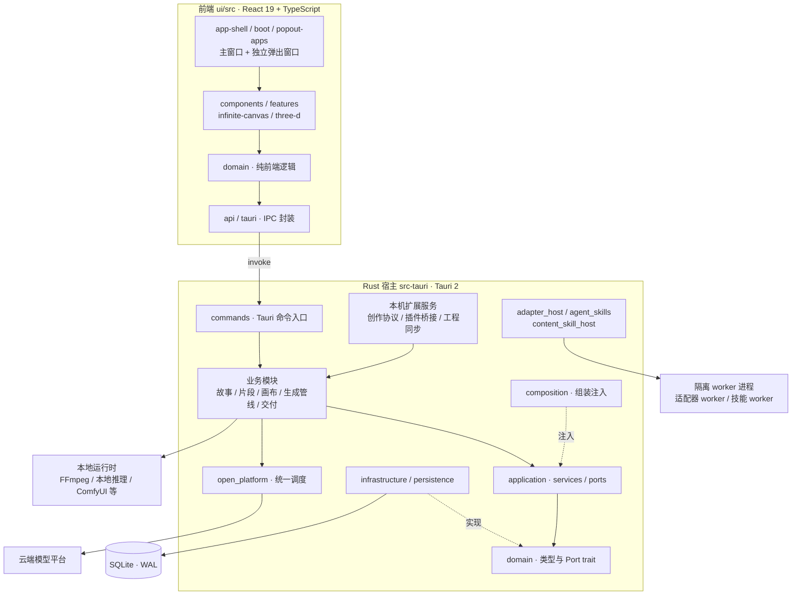

# 项目综述（bgxiong-ai-story）— 比格熊数字导演工作站

| 项 | 说明 |
|----|------|
| **文档性质** | 面向技术读者的项目全景：定位、桌面架构、模块地图、工程规模与技术栈。实现细节以同目录其它技术文档及《全仓整体架构设计》为准。 |
| **更新日期** | **2026-11-12**（Asia/Shanghai） |
| **对应版本** | 应用版本 **v0.6.1113**（版本号 SSOT 为桌面配置中的 `version` 字段；宿主编译身份 crate 版本固定，不随发版数字变动） |
| **源码依据** | 私有源仓库 `main` 提交短 SHA `9060e84b8`。源工作区另有与助手模块相关的未提交改动，**未**作为本稿依据。 |
| **架构权威** | 现行架构事实以 [20261104-ARCH-全仓整体架构设计](../02-架构设计/20261104-ARCH-全仓整体架构设计.md) 为准。本文是按 2026-11-12 目录、工作区 crate 与规模统计校对后的开源综述。 |
| **统计口径** | 仅统计 Git 跟踪的自研源码，不含第三方依赖、自动生成安装包、`docs/` 与历史文档目录、生成物目录、lock 文件，以及 JSON / TOML / YAML 配置与数据文件。下表「有效代码行」不含空行与整行注释；「物理行」含空行与注释。因口径与工具可能和历史文档不完全相同，**不可与 2026-07 或 2026-10 的数字逐项对比**。 |
| **脱敏说明** | 开源版不包含登录、认证、账号、激活、支付、计费及相关云端服务的实现、接口、配置与运营细节。文中若涉及这些能力，只说明「产品包含此类能力，开源文档已省略」。本机回环服务只描述能力边界，不列出具体端口、鉴权方式或调用步骤。 |
| **历史对照** | 早期综述快照已移至 [历史演进目录](../../archive/history/README.md)，不作为现行设计依据。 |

---

## 1. 定位概览

比格熊数字导演工作站（bgxiong-ai-story）是一套 **AI 驱动的桌面端影视创作平台**，产品形态是安装在电脑上的 Windows 桌面客户端（而非「打开浏览器即用」的纯网页产品）。它把故事结构、角色与演员资产、分镜与片段工作台、自由画布，以及文本 / 图像 / 视频 / 语音 / 音乐生成链路放在 **同一套本地工程与同一个应用** 里完成，面向影视、短视频、动漫与教育实训等前期创意与试制场景。

当前创作主线是 **故事 → 剧集 → 片段**。故事与剧集规划之后，由片段工作台产出视频稿与相关提示词并生成、采纳。自由画布不必先建完整故事，可直接组织图像、视频与文本节点。两条路径共用模型配置、演员库与设置。

在现行桌面主导航的故事分组中，日常入口是故事、角色、故事道具、剧集与片段；其中「片段」对应 `clips` 标签，实现为片段工作台（`clip_workflow` / `ClipWorkflowTab`），而不是已退役的旧 Clips 模块。历史标签 `scenes`（场次）、`storyboard`（故事板）、`segments`（旧片段画布入口）会规范化到现行片段工作台，不再作为独立日常创作入口。资产分组中的「场景资产」（`sceneAssets`）是现行视觉资产，与已退役的故事层级「场次」不是同一概念。仓库中仍保留场次 / 故事板 / 旧 Clips 等相关实现代码，但已不再作为扩展方向，也不得把这些存量界面或历史文档当成现行设计。

云端模型在本产品中的角色，更接近 **用户按需接驳的能力**：用来完成某次生成或某种模型推理；**工程本体、数据结构、任务编排、设置与日志** 仍以客户端与本地存储为主轴。这与「做一个网站外壳、只转发接口」有本质区别。

---

## 2. 市场视角

- **需求背景**：多工具并行（文档、表格、浏览器里各家模型页面）容易造成上下文断裂、素材与版本散落；创作方难复盘「用了哪家模型、最终下过怎样指令」。
- **产品切入点**：用结构化本地工程承接创意流程；用户在设置与各界面里明确选定文本、配图、改图、视频、语音等通道，系统按选择执行，不做用户未同意的暗中替换。
- **典型用户**：独立创作者、小型制作组、内容团队与院校实训等需要在可控环境下批量试制 AI 辅助前期的群体。

---

## 3. 为什么是桌面客户端

下面几条概括客户端路线相对「云端套壳」或「纯浏览器工具」的差异；不是说「完全不用云」，而是 **云服务于生成能力，客户端承载创作资产与工业流程**。

- **工程与数据默认在用户自己电脑上。** 故事结构、分镜、画布、任务记录、素材引用等落在本地数据库与本地目录；故事还可以导出为 `.bgxstory` 备份包。
- **不绑死在浏览器标签页的生命周期。** 客户端像普通办公软件一样常驻本机，打开即是同一套界面与同一套工程逻辑。
- **云端是可选能力，不是唯一脊梁。** 需要生图、生视频、语音时再按用户选择访问开放平台；同时支持本地推理（如文本 / 视觉本地服务、语音识别、ComfyUI 本地工作流），弱网、断网或保密环境下仍可编辑工程、跑本地模型。
- **更深地接入本机能力。** 日志与诊断、数据目录、本地运行时、FFmpeg 媒体处理，以及与后期软件插件、外部智能体客户端的本机对接，都是操作系统级客户端擅长的领域。
- **复杂界面与大体量交互按桌面性能预期来做。** 例如大面积无限画布、多标签工作台、可独立弹出的多窗口、长列表任务中心，采用视口裁剪与资源回收，而不是在网页里「凑合能用」。

---

## 4. 产品与系统概要

- **形态**：Windows 10/11 64 位桌面应用。界面用 React 19 + TypeScript 5.9 编写，跑在 Tauri 2 提供的 WebView 中；业务逻辑、数据与外部调用由同进程的 Rust 宿主承担。
- **数据**：本地 SQLite（WAL 模式，连接池）。仓储实现集中在基础设施层的 SQLite 适配。故事可整体导出 / 导入为 `.bgxstory` 备份包，也可在本机之间同步工程。开源版不展开云端同步协议细节。
- **智能能力**：云端模型经统一调度出口按用户所选通道执行；本地有文本 / 视觉推理、语音识别、ComfyUI 工作流，以及按需下载的语音、音乐、音频处理运行时。
- **任务与留痕**：AI 任务统一落库，按提交、进行中、结束展示；应用重启后会回收尚未结束的异步媒体任务。请求发出前，下发给所选模型的最终指令会写入日志与任务记录。系统禁止自动轮询其它通道、悄悄兜底，或在参考图失败时暗中改成纯文字生图。
- **对外扩展**：本机可向外部智能体（例如兼容 MCP 的客户端）与后期软件插件提供创作能力；第三方算力适配器以 WebAssembly 组件形式运行在独立 worker 进程中。同时支持标准 Agent Skills（`SKILL.md`）与内容技能。开源版不列出本机服务的具体端口、鉴权方式与调用步骤。
- **账号与商业能力**：产品包含账号、授权与商业化相关能力。**开源版不包含这些模块的流程、接口、配置与实现说明。**

### 4.1 设计上值得单独说的几点

- **用户选定的模型才生效，禁止暗中换通道。** 这对采购合规、成本可归因、结果可复现很重要。
- **最终指令、任务过程与用量可追溯。** 多步骤、多模态的长链路事后可以按时间线对齐。
- **每类能力只有一个调度出口。** 文本、图像、视频、语音合成等各自收敛到可审计的调度入口，业务管线不直接拼接各家接口。
- **跨语言合同单一来源。** Rust 与 TypeScript 共用的数据合同放在 `packages/app-contracts/v1`（截至本稿为 212 份 JSON）。Rust 侧在构建期生成常量，前端读取同一份定义。禁止 TypeScript 与 Rust 双写等价业务规则。
- **演员库与故事解耦，能力映射统一模型列表。** 「演员」是不依附于某个故事的全局资产，可跨项目复用。
- **自研无限画布内核。** 分镜、片段画布、自由画布等界面共用 `ui/src/infinite-canvas`（约 197 个 TypeScript / TSX 文件）：空间索引、视口裁剪、瀑布流布局与缩放平移均为自研实现，不依赖第三方商业画布库。
- **门禁脚本守护约定。** `scripts/` 下现有约 323 个 `check-*.ps1` 门禁，覆盖命名、单一来源、分层边界等约定；工作区 crate 的职责由角色登记表校验，确保 GUI 宿主的依赖闭包中不出现 Wasmtime。

---

## 5. 整体架构

### 5.1 总览

### 5.2 进程与分层

产品是单机桌面应用：GUI 宿主进程内是 Tauri WebView 与 Rust 业务；第三方适配器和内容技能在独立 worker 进程中执行，避免不可信代码拖垮界面；FFmpeg、本地推理、Python sidecar、ComfyUI 等作为隐藏窗口的本地子进程运行。

宿主分层与依赖方向（均有门禁守护）：

| 层 | 允许 | 禁止 |
|----|------|------|
| 接口层（Tauri 命令、本机服务入口） | 参数校验、DTO 映射、委托应用服务或统一内核 | 直接持有数据库连接、在入口堆业务分支 |
| 应用层 `application/` | 依赖端口、领域类型、纯核心 crate | 直接写 SQL 或跨层使用连接句柄 |
| 领域层与 pure-core crate | 纯类型与规则 | 桌面框架、SQLite、HTTP、异步运行时、直接文件 / 网络 / 进程 IO |
| 基础设施与 `db/` | 唯一持有连接与 SQL | 产品文案、UI 状态、IPC 形状 |
| 平台层 `platform/` | 操作系统能力接口与桌面实现 | 业务逻辑 |
| 组合根 `composition/` | 组装与注册 | 业务实现 |

事务约束：文件、网络、模型调用、子进程与等待都在事务外完成，最后用短事务登记元数据。相关专题的历史说明见 [数据库短事务与文件先落盘规范](../../archive/history/release/03-开发指南/20261028-GUIDE-数据库短事务与文件先落盘规范.md) 与 [持久化层六边形架构](../../archive/history/release/03-开发指南/GUIDE-持久化层六边形架构.md)（均为历史演进文档，不作为现行架构依据）。

### 5.3 Rust 工作区

`src-tauri/Cargo.toml` 定义 Cargo 工作区：主 crate（GUI 宿主）加上 `src-tauri/crates/` 下 **20** 个子 crate。其中 **19** 个已在角色登记表中声明职责并由门禁校验依赖闭包；`bgx-adapter-v2-media-host` 已加入工作区但尚未登记角色。截至 2026-11-12，已登记角色划分如下：

| 角色 | 含义 | crate |
|------|------|-------|
| `pure-core` | 纯规则与合同：无桌面框架 / SQLite / 网络 / 异步运行时 / 文件 IO | `bgx-agent-skills-core`、`bgx-asr-core`、`bgx-comfy-workflow`、`bgx-creator-request-core`、`bgx-desktop-net-tests`（仅测试）、`bgx-media-core`、`bgx-motion-core`、`bgx-sound-core`、`bgx-tts-ref-core`、`bgx-video-prompt-contract`、`bgx-video-span-core` |
| `infrastructure` | 可以使用 SQLite，不直接做网络与宿主编排 | `bgx-db-core`、`bgx-video-span-sqlite` |
| `runtime` | 在隔离进程中执行 WASM | `bgx-skill-runtime` |
| `transport` | 宿主与 worker 的进程协议 | `bgx-skill-transport` |
| `tool` | 作者 / 开发命令行 | `bgx-skill-tools` |
| `build-support` | 构建期合同生成与校验 | `bgx-contract-gen`、`bgx-creator-contract`、`bgx-installer-preset` |

第三方算力适配器的运行时与工具链不全部放在本工作区，而以独立适配包 + 宿主 `adapter_host` 的方式接入。仓库根目录 `src/` 仍保留早期命令行原型，不参与桌面应用构建。

### 5.4 前端分层（`ui/src`）

| 层 | 目录 | 职责 |
|----|------|------|
| 传输 | `api/`、`tauri/` | 调用封装与原始错误，不含业务排序或规则 |
| 应用 | `application/` | 组合多次调用的用例 |
| 领域 | `domain/`（约 262 个子目录） | 纯逻辑：解析、投影、状态派生；不直接发起桌面调用 |
| 展示 | `components/`（约 123 个子目录）、`features/`、`settings/` | 组件与页面，只订阅状态、调用用例 |
| 外壳 | `app-shell/`、`boot/`、`popout-apps/` | 主窗口、启动、独立弹出窗口、全局助手窗口；`ui/` 下约有 21 个 HTML 入口 |
| 内核 | `infinite-canvas/`、`graph-core/`、`three-d/` | 自研无限画布、前端图模型、3D 辅助 |

共享壳（跨宿主唯一实现）包括生图工作台三栏、视频工作台三栏，以及媒体节点外壳与连线动效。界面文案支持简体中文与英文。

---

## 6. 后端核心模块地图

宿主 `src-tauri/src` 在 2026-11-12 约有 154 个顶层目录与 162 个顶层源文件，合计约 3,834 个 Rust 源文件。除分层目录外，其余按业务能力切为竖条，需要持久化时经端口进入基础设施层。下表只列公开讨论的能力方向，不展开未公开接口。

| 模块群 | 主要模块 | 职责与状态 |
|--------|----------|------------|
| **片段创作主线** | `clip_workflow`、`clip_framework`、`segment_canvas`、`video_span`、`story_creation`、`script_segment` | 现行主线：故事 → 剧集 → 片段 |
| **旧编排（存量）** | `chapter_scenes_plan`、`storyboard_*`、`clips`、`scene_concept_plate` | 不再扩展，按架构文档中的清单化原则处理，禁止整目录盲目删除 |
| **画布** | `free_canvas`、`canvas_*`、`media_canvas`、`graph_core`、`workflow_graph_store` | 自由画布、媒体节点、图存储 |
| **角色与资产** | `visual_asset`、`portrait_*`、`appearance`、`story_prop*`、`story_role_generation` | 演员 / 角色 / 肖像 / 道具与场景资产 |
| **图像与视频生成** | `image_generation`、`segment_video_pipeline`、`video_prompt_*`、`video_*`、`image_upscale` | 生图、片段视频、提示词管线、超分与后续处理 |
| **声音** | `speech`、`voice_studio`、`music_generation`、`sfx_generation`、`sound_design`、`audio_*`、`vocal_separate`、`singing_relyrics`、`asr` | 配音、音乐、音效、降噪、人声分离、翻录转唱、语音识别 |
| **数字人与后期** | `lipsync_provider`、`talking_presenter`、`postproduction_decoration`、`generative_video_edit*` | 口播 / 后期模板 / 生成式视频编辑；部分能力仍标为实验性 |
| **交付** | `production_delivery`、`video_delivery`、`auto_edit`、`highlight_pipeline`、`clips_export` | 统一交付、自动剪辑、高光与导出 |
| **智能体** | `assistant_agent`、`creator_tools`、`creator_requests`、`creator_changeset`、`mcp_creator` | 全局助手与外部智能体共用一套创作工具内核与目录 |
| **扩展** | `adapter_host`、`agent_skills`、`content_skill_host`、`comfyui` | 第三方适配器、Agent Skills、内容技能、ComfyUI 工作流 |
| **数据** | `db`、`migration`、`story_backup`、`project_sync` | 连接池与 schema、备份包、工程同步 |
| **运维向能力** | `runtimes`、`media_runtime`、`local_gpu_occupancy`、`bug_report`、`disk_cleanup` 等 | 本地运行时、GPU 占用探测、诊断与清理 |
| **账号 / 授权 / 商业化** | （存在相应模块） | **开源版已省略这些模块的实现说明** |

---

## 7. 前端核心模块地图

前端 `ui/src` 在 2026-11-12 约有 6,592 个 TypeScript / TSX 文件。主窗口包含故事、资产、演员、角色、剧集、片段、配音、音乐、自由画布、任务、帮助、设置等标签页；多数页面可作为独立窗口弹出，此外还有全局助手窗口。

| 目录 | 约略规模 | 职责 |
|------|----------|------|
| `domain/` | 约 3,997 个文件、262 个子目录 | 前端纯逻辑（画布、生成、肖像、模型选择、助手、工作台等） |
| `components/` | 约 1,693 个文件、123 个子目录 | 界面组件（现行片段工作台、剧集、自由画布、设置、本地模型、助手等；历史故事板等界面代码仍可能存在于源码树，不代表现行入口） |
| `infinite-canvas/` | 约 197 个文件 | 自研无限画布内核 |
| `features/` | 约 203 个文件 | 角色、演员等标签页（历史场次标签在现行装配中已不再作为独立日常入口） |
| `settings/` | 约 80 个文件 | 设置与偏好（开源版不展开账号与凭证相关页） |
| `api/`、`tauri/` | 约 56 + 11 个文件 | 桌面调用封装 |
| `popout-apps/`、`app-shell/`、`boot/` | 约 38 + 39 + 16 个文件 | 弹出窗口、外壳、启动 |
| `three-d/` | 约 35 个文件 | 基于 three.js 的 3D 辅助 |
| `graph-core/`、`layout-persistence/` | 约 17 + 23 个文件 | 前端图模型、布局持久化 |
| 认证相关目录 | — | **开源版已省略实现说明** |

---

## 8. 合同、运行时与本地能力

- **合同包（`packages/`）**：`app-contracts/v1`（跨语言数据合同，212 份 JSON）、`vendor-adapter-contract`（适配器 SDK 合同）、`local-bridge-contract`、`project-sync-contract`、`local-runtime-contract`、`motion-contract`、`content-skill-sdk-ts`、`creator-client`、`speech-intent` 等。与本机服务协议相关、但涉及未公开鉴权或运营细节的合同包，开源版不展开。
- **本地运行时**：按需下载或随离线包安装，常见类别包括 FFmpeg、本地文本推理、Whisper 语音识别、Python sidecar、TTS、音乐、人声分离、音效等。就绪状态分层探测，上层“已就绪”不得自动推导下层也已就绪。
- **ComfyUI**：工作流原件与说明位于 `ComfyUI-API/`；映射合同、导入路径与离线包是现行集成方式。详见架构文档与开发指南中的工作流映射合同。
- **已出现在公开综述中的云端能力类型**（只列类型，不以本文冒充实时厂商清单）：文本、图像、视频、语音、音效、数字人、视频超分；同时支持 OpenAI 兼容文本接口与本地 / ComfyUI 通道。具体可用厂商以软件内能力映射与用户手册为准。

---

## 9. 工程规模与技术栈

**研发体量（2026-11-12，源提交 `615a8d70e`，按上文口径）**

| 类别 | 文件数 | 有效代码行（约） | 物理行（约） |
|------|--------|------------------|--------------|
| 后端与桌面服务（Rust） | 4,103 | 110.5 万 | 123.1 万 |
| 其中：宿主 `src-tauri/src` | 3,837 | 105.7 万 | 117.7 万 |
| 其中：工作区子 crate | 209 | 3.7 万 | 4.2 万 |
| 前端 TSX | 1,320 | 26.2 万 | 28.8 万 |
| 前端 TypeScript | 5,366 | 47.2 万 | 55.7 万 |
| 前端 TS / TSX 合计 | 6,686 | 73.4 万 | 84.6 万 |
| 工程脚本（PowerShell） | 534 | 8.5 万 | 9.8 万 |
| 小型工具脚本（Python） | 280 | 4.1 万 | 4.8 万 |
| 其他（JS、CSS、SQL、HTML、安装脚本等） | 147 | 1.7 万 | 2.0 万 |
| **自研程序合计** | **约 11,750** | **约 198 万** | **约 224 万** |

> 宿主顶层模块数量、合同文件数与门禁脚本数见上文。与 2026-07-24（约 73 万行物理口径）和 2026-10-04（约 147 万有效代码行）的差异，既来自仓库增长，也可能来自统计口径变化，请勿直接做减法。

**技术栈明细（取自当前清单，不列出私钥、证书或内部源地址）**

| 层 | 技术选型 |
|----|----------|
| 桌面壳 | Tauri 2（插件包括 updater、process、dialog、fs、clipboard-manager、single-instance） |
| 前端 | React 19.2、TypeScript 5.9、Vite 8、three.js 0.184、Vitest 4.1 |
| 后端语言 | Rust（edition 2021） |
| 异步与网络 | Tokio；reqwest 0.13；axum 0.7；tokio-tungstenite |
| 数据库 | SQLite（rusqlite 0.32 bundled，WAL，r2d2 连接池） |
| 模板与日志 | Tera；tracing（subscriber + appender） |
| 本地推理 | 本地推理服务、Whisper（命令行运行时；进程内绑定为可选特性）；candle 0.8 + tokenizers |
| 扩展运行时 | 独立 worker 进程执行 WASM 组件 |
| 媒体与文档 | FFmpeg（外部运行时）；image 0.25；zip、quick-xml、rtf-parser、encoding_rs、pinyin |
| 安装与更新 | 安装包与版本化更新机制；开源版不展开云端登记与签名分发流程 |

---

## 10. 已知差距（与架构文档一致）

- 持久化六边形升级与泄漏收口已经完成主要阶段，但宿主仍有少量直接依赖 SQLite 的债务，由基线棘轮约束只降不升。
- 宿主顶层模块仍然平铺较多，整组迁移暂缓，先做低风险切片。
- 旧编排代码与片段主线并存，禁止把「不再扩展」理解成可以整目录删除。
- 前端 `domain/` 子目录很多，`application/` 层相对较薄，正在按文件级计划归并纯函数与保存用例。
- 根目录早期 CLI 原型仍保留，暂不删除。

更完整的现状与重构原则见 [全仓整体架构设计](../02-架构设计/20261104-ARCH-全仓整体架构设计.md)。

---

*本文根据私有源仓库的现行文档与目录实证整理，供学习参考。源项目源代码与商业使用权归原作者所有。*
