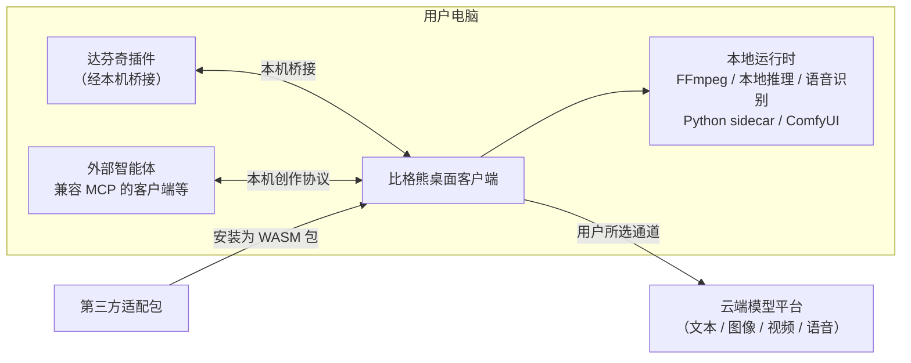
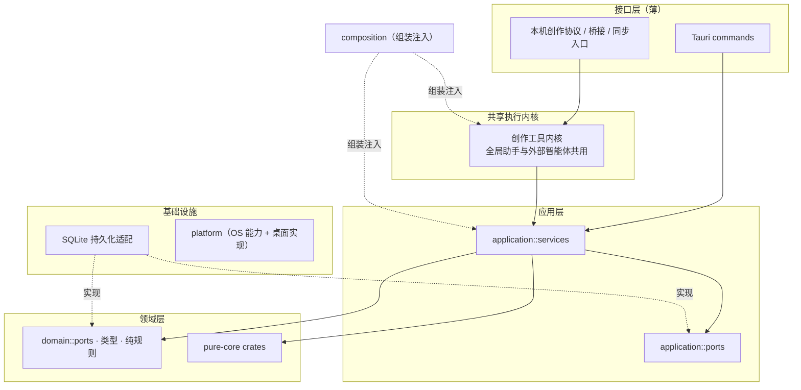

# ARCH · 全仓整体架构设计（开源整理版）

| 项 | 说明 |
|---|---|
| 原文档时间 | 2026-11-04（Asia/Shanghai） |
| 原对应代码 | 源仓库当时的 `main` 短 SHA `be67fdcfd`，应用版本 `0.6.1106` |
| 开源整理 | 2026-11-12（Asia/Shanghai），按源仓库 `main` 短 SHA `9060e84b8`（此前整理对照 `615a8d70e`；其后为短提交，创作主线结论未变）、应用版本 `0.6.1113` 核对目录、工作区 crate、模块划分，并再次核对主导航与创作工具发布面后脱敏发布 |
| 文档性质 | 全仓整体架构总图：系统边界、进程拓扑、分层与依赖方向、crate 职责、横切机制的定位、现状差距 |
| 开源处理 | 删除或改写账号 / 授权 / 计费 / 未公开端点 / 私有仓库路径等敏感内容；文件级重构执行清单与内部验收日志改为原则说明，避免把未在开源环境复跑的测试结果写成结论 |

本文是公开技术文档中的**现行架构权威稿**。历史专题指南、规范与早期架构叙述已移至 `archive/history/`，属于历史演进资料，**不代表当前设计，不作为当前实现或开发依据**。若发现现行实现与本文冲突，以源码与本文的后续修订为准。

---

## 0. 读法

- §1–§6 是**现状事实**（as-is），均可在源仓库目录或门禁中找到对应物。
- §7 列横切机制各自唯一的实现位置，改相关代码前先看这里找单一来源。
- §8.1 是 2026-11-12 按源码核对的现行产品装配与已退役创作面。
- §9 是现状与目标之间的**已知差距**，如实记录，不粉饰。
- 源仓库另有文件级分阶段重构计划。开源版只保留原则、阶段目标与暂缓边界，不抄录内部执行回执、失败日志或未公开门禁细节。

---

## 1. 系统边界

产品是 Windows 桌面客户端（Tauri 2）。工程数据、任务记录与日志以本机为主轴；云端模型是用户按需选择的能力，不是唯一脊梁。

产品还包含账号、授权与资源分发相关的云端能力，以及若干平级开发仓库（例如适配器源码仓、旧库转换工具、ComfyUI 发行物料）。**开源版已省略这些仓库的路径、运营关系和认证/计费实现。** 交付给用户后的安装目录与应用数据根沿用产品自己的合同，不要求用户拥有开发机上的平级仓库。

公开技术文档可以确认的外围关系只有能力边界：

- 达芬奇插件通过本机桥接调用客户端能力，插件侧不承担宿主业务逻辑。
- 第三方适配器以独立源码与 SDK 合同维护，安装为 WASM 包；宿主禁止按厂商或插件标识做特殊分支。
- 旧库转换由独立工具完成；主程序只认当前库合同，不在运行时做兜底式改表。
- ComfyUI 工作流的认证源仍是本仓库 `ComfyUI-API/` 中的原件与说明。

---

## 2. 进程拓扑

| 进程 | 内容 | 隔离理由 |
|---|---|---|
| GUI 宿主 | Tauri WebView（React UI）+ 同进程 Rust 宿主（业务、SQLite、调度） | 主进程；依赖闭包禁止出现 Wasmtime |
| 适配器 worker | 第三方适配器 WASM 组件执行 | 不可信代码，崩溃不影响 GUI |
| 技能 worker | 内容技能 WASM 执行 | 同上；每次调用使用独立隐藏进程 |
| 本地运行时子进程 | FFmpeg、本地推理、语音识别、Python sidecar、ComfyUI 等 | 一律经平台层以隐藏窗口方式拉起 |

宿主同进程还对外提供若干**本机回环服务**，用于外部智能体、后期插件桥接和工程同步。开源版只保留能力名称：创作协议服务、本机能力出口、达芬奇插件桥接、项目同步。**不列出具体端口、鉴权方式、调用步骤或配置键。**

---

## 3. 宿主分层与依赖方向

### 3.1 依赖规则（现行，均有门禁）

| 层 | 允许 | 禁止 | 门禁方向 |
|---|---|---|---|
| 接口层 | 参数校验、DTO 映射、委托 service / kernel | 直接持有数据库连接、在入口堆业务分支 | 持久化架构检查 |
| `application/` | 依赖 port、领域类型、纯核心 crate | 直接写 SQL 或调用仓储私有实现 | 同上，并配合债务棘轮 |
| `domain/` 与 pure-core crate | 纯类型与规则 | 桌面框架、SQLite、HTTP 客户端、异步运行时、直接文件 / 网络 / 进程 IO | 工作区 crate 角色检查 |
| 持久化实现与 `db/` | 唯一持有连接与 SQL | 产品文案、UI 状态、IPC 形状 | 持久化架构检查 |
| `platform/` | OS 能力接口与桌面实现 | 业务逻辑 | 平台边界检查 |
| `composition/` 与启动入口 | 组装与注册 | 业务实现 | 架构总闸 |

事务与持锁另有短事务约束：文件、网络、模型、子进程与等待都在事务外，最后用短事务登记元数据。相关历史专题见 [数据库短事务与文件先落盘规范](../../archive/history/release/03-开发指南/20261028-GUIDE-数据库短事务与文件先落盘规范.md)（历史演进文档，不作为现行架构依据）。

### 3.2 业务模块的组织方式

截至 2026-11-12，宿主 `src-tauri/src` 约有 154 个顶层目录与 162 个顶层源文件（约 3,834 个 `.rs`）。除上述分层目录外，其余都是按业务能力切的竖条，例如 `free_canvas`、`clip_workflow`、`segment_canvas`、`image_generation`、`speech`、`production_delivery`。竖条内部自带命令入口、服务与规则；需要持久化时经 port 进入基础设施，不在竖条里直连 SQL（存量例外由债务棘轮守住，只减不增）。

---

## 4. Rust 工作区与 crate 职责

`src-tauri/Cargo.toml` 是工作区：主 crate 为 GUI 宿主，加上 `src-tauri/crates/` 下 **20** 个子 crate。其中 19 个已登记角色并由门禁校验依赖闭包；`bgx-adapter-v2-media-host` 已加入工作区但尚未登记角色。

| 角色 | 含义 | crate（2026-11-12 核对） |
|---|---|---|
| `pure-core` | 纯规则与合同 | `bgx-asr-core`、`bgx-agent-skills-core`、`bgx-comfy-workflow`、`bgx-creator-request-core`、`bgx-desktop-net-tests`（仅测试）、`bgx-media-core`、`bgx-motion-core`、`bgx-sound-core`、`bgx-tts-ref-core`、`bgx-video-prompt-contract`、`bgx-video-span-core` |
| `infrastructure` | 可用 SQLite，不碰网络与宿主装配 | `bgx-db-core`、`bgx-video-span-sqlite` |
| `runtime` | 在隔离进程执行 WASM | `bgx-skill-runtime` |
| `transport` | 宿主与 worker 的进程协议 | `bgx-skill-transport` |
| `tool` | 作者 / 开发命令行 | `bgx-skill-tools` |
| `build-support` | 构建期合同生成与校验 | `bgx-contract-gen`、`bgx-creator-contract`、`bgx-installer-preset` |

2026-11-04 原稿还提到适配器运行时一类 crate。核对 2026-11-12 工作区成员后，这些适配器运行时并不都在本工作区中；现行方式是独立适配包 + 宿主 `adapter_host`。宿主访问下沉 crate 走单一门面，业务代码不直接依赖基础设施 crate 的内部路径。

仓库根 `src/` 是早期命令行原型，不参与桌面应用构建。

---

## 5. 前端分层（`ui/src`）

| 层 | 目录 | 职责（2026-11-12 规模） |
|---|---|---|
| 传输 | `api/`、`tauri/` | 调用封装与原始错误；不含业务排序或规则 |
| 应用 | `application/` | 组合多次调用的用例（加载、刷新、合并、部分保存） |
| 领域 | `domain/`（约 262 个子目录） | 纯逻辑：解析、投影、状态派生；不直接发起桌面调用 |
| 展示 | `components/`（约 123 个子目录）、`features/`、`settings/` | 组件与页面，只订阅状态、调用用例 |
| 外壳 | `app-shell/`、`boot/`、`popout-apps/` | 主窗口、启动、独立弹出窗口、全局助手窗口；`ui/` 下约 21 个 HTML 入口 |
| 内核 | `infinite-canvas/`、`graph-core/`、`three-d/` | 自研无限画布、前端图模型、3D 辅助 |

已落地的目录归位包括：画布缩放纯规则进入 `domain/canvas/viewport-scale/`，演员编辑保存用例进入 `application/assets/`，剧集保存用例进入 `application/authoring/`，纯字段补丁规则留在领域层。其它领域目录仍沿现状，未全量归并。

共享壳（跨宿主唯一实现，宿主只接数据、动作与保存归属）：生图工作台三栏、视频工作台三栏、媒体节点外壳与连线方向动效。

前后端分工：计算量大、调用极频、复杂不变式与持久化放 Rust；TypeScript 只做薄编排与展示。禁止两侧双写等价业务规则。

---

## 6. 跨语言与跨组件合同

| 合同包（`packages/`） | 用途 |
|---|---|
| `app-contracts/v1`（2026-11-12 为 212 份 JSON） | 两端共用的上限、事件名、哨兵、闭集、创作工具目录；Rust 经构建脚本生成常量，前端相对路径导入 |
| `vendor-adapter-contract` | 适配器 SDK 合同，平台无关 |
| `local-bridge-contract`、`project-sync-contract`、`local-runtime-contract`、`motion-contract` | 本机桥接、工程同步、本地运行时、动画模板 |
| `content-skill-sdk-ts`、`creator-client`、`speech-intent` | 内容技能辅助类型、随包创作客户端、语音意图纯核心 |

涉及未公开鉴权或运营细节的合同包，开源版不展开字段与接入步骤。

IPC 数据形状：SQLite `snake_case` ↔ IPC `camelCase` ↔ 前端 API 类型，一人一义，禁止别名双键。新 IPC 必须带前端真实 payload 的 Rust 反序列化单测。

---

## 7. 横切机制与唯一实现位置

改下列能力时，先找表中的单一来源，禁止另起第二条路径。

### 7.1 AI 调用与任务

| 机制 | 单一来源 | 规则 |
|---|---|---|
| 云端调度 | `open_platform`（文本 / 图像 / 视频 / 语音合成各一个出口） | 按用户所选执行；禁止轮询、降级、静默换通道 |
| 文本调度 | 唯一出网入口 | 本地与云端同一入口 |
| 任务记录 | `ai_tasks` 表的标准状态迁移 | 唯一任务系统 |
| 最终提示词 | HTTP 前同时写日志与任务记录 | 发出去的指令必须可追溯 |
| 厂商用量 | 合并真实返回量 | 禁止估算冒充 |
| 厂商错误 | 错误目录 + 前端展示解析 | 用户看人话，机码进日志 |
| 重启回收 | `async_media_resume/` | 远端已受理的异步任务重启后必须拿回终态 |

### 7.2 智能体统一协议

全局助手与外部智能体客户端共用一个创作工具内核、一份工具目录、同一套 schema、错误与请求续办协议。客户端只做调度、传输和呈现，不各自实现一套业务。

### 7.3 数据

| 机制 | 单一来源 |
|---|---|
| 存储 | SQLite WAL + 连接池（`bgx-db-core`），schema 编排在宿主 `db/` |
| 升级 | 旧库转换只在独立工具中进行；主程序禁止运行时兜底改表 |
| 短事务 | 见短事务指南 |
| 备份 / 同步 | `story_backup`（`.bgxstory`）、`project_sync`（两端不一致时必须询问以哪端为准） |
| 撤销 | 当前画布会话最近 50 步；历史专题见 [撤销窗口与会话生命周期](../../archive/history/release/03-开发指南/20261101-GUIDE-撤销窗口与会话生命周期.md)（不作为现行架构依据） |

### 7.4 媒体与文件

新媒体文件名、图片扩展名与魔数一致性、孤儿文件引用登记、超大 payload 显式报错，都有各自唯一实现位置，禁止在业务竖条里再写一套。

### 7.5 扩展体系

| 扩展 | 宿主模块 | 关键约束 |
|---|---|---|
| 第三方算力适配器（WASM） | `adapter_host` | SDK 平台无关；厂商语义只在独立适配器；宿主禁止按插件或厂商标识特判 |
| Agent Skills（`SKILL.md`） | `agent_skills` + `bgx-agent-skills-core` | 用途闭集；按片段主流程接入 |
| 内容技能 | `content_skill_host` + `bgx-skill-*` | 隔离 worker 执行 |
| ComfyUI 工作流 | `comfyui` + `bgx-comfy-workflow` | 原件旁路保留；验收必须走用户导入路径 |
| 动画模板 | 后期模块 + `bgx-motion-core` | 以 `motion-contract` 为合同 |

### 7.6 本地运行时

运行时清单在 `runtimes/`，按需下载或随离线包安装到应用数据目录下的运行时树。就绪分多层探测：产物是否在盘、运行时树与进程内探针、服务健康。上层显示“已就绪”不得自动推导下层也已就绪。上游未升版时，本地运行时不得自行升版。

### 7.7 可观测性与错误

- 日志：开发态写项目日志目录，安装版写应用数据目录下的日志。后端用 `tracing`，前端用统一日志入口。
- 用户可见文案用本地化人话；机码、原始错误和堆栈只进日志。
- 跨窗 / 跨进程链路的关键节点必须落日志，失败通道必填。

---

## 8. 业务领域地图（按当前产品方向）

当前创作主线是 **故事 → 剧集 → 片段**。旧的场次 / 故事板编排与旧 Clips 模块已不再作为扩展方向，代码仍在仓库中，按清单化原则处理。装配与发布面的核实见 §8.1。

| 领域群 | 主要模块 | 状态 |
|---|---|---|
| 片段创作主线 | `clip_workflow`、`clip_framework`、`segment_canvas`、`video_span`、`story_creation`、`script_segment` | 现行主线 |
| 旧编排（存量） | `chapter_scenes_plan`、`storyboard_*`、`clips`、`scene_concept_plate` | 不扩展，禁止整目录删除 |
| 画布 | `free_canvas`、`canvas_*`、`media_canvas`、`graph_core`、`workflow_graph_store` | 现行 |
| 角色与资产 | `visual_asset`、`portrait_*`、`appearance`、`story_prop*`、`story_role_generation` | 现行 |
| 图像 / 视频生成 | `image_generation`、`segment_video_pipeline`、`video_prompt_*`、`video_*`、`image_upscale` | 现行 |
| 声音 | `speech`、`voice_studio`、`music_generation`、`sfx_generation`、`sound_design`、`audio_*`、`vocal_separate`、`singing_relyrics`、`asr` | 现行 |
| 数字人与后期 | `lipsync_provider`、`talking_presenter`、`postproduction_decoration`、`generative_video_edit*` | 部分实验性 |
| 交付 | `production_delivery`、`video_delivery`、`auto_edit`、`highlight_pipeline`、`clips_export` | 现行 |
| 智能体 | `assistant_agent`、`creator_tools`、`creator_requests`、`creator_changeset` | 现行（统一协议） |
| 账号与授权 | — | **开源版已省略** |
| 运维向 | `runtimes`、`bug_report`、`disk_cleanup`、本地运行时与下载相关模块 | 现行；更新与分发流程开源版不展开 |

### 8.1 现行产品装配与已退役创作面（2026-11-12 源码核对）

核对依据：源仓库 `main` 短 SHA `9060e84b8`（此前整理对照 `615a8d70e`；其后为短提交，创作主线结论未变）的前端主窗口装配、主导航规范化，以及创作工具目录与「已退出创作发布面」清单。源工作区另有与助手模块相关的未提交改动，**未**作为本结论依据。

**现行创作主线**是 **故事 → 剧集 → 片段**。故事创建侧提供剧集生成与片段生成等现行能力；片段工作台由 `clip_workflow` 提供读写、变更准备、帧与批次等现行能力。桌面主窗口将「片段」标签装配为 `ClipWorkflowTab`。

**现行主导航（故事分组日常入口）**：故事、角色、故事道具、剧集、片段。此外还有场景资产、人物资产、道具资产、配音、音乐、音效、自由画布、任务、帮助、设置等现行入口。

**已从日常创作入口与创作工具发布目录撤下的编排面**：

- 故事板：历史 `storyboard` 标签，以及故事板交接、故事板生成等能力，不再进入现行工具发布目录，也不再作为独立日常创作入口。
- 作为故事层级阶段的「场次」：历史 `scenes` 标签及场次生成等能力，不再进入现行工具发布目录，也不再作为独立日常创作入口。
- 旧 Clips 与旧片段画布日常入口：历史 `segments` 标签及旧 Clips 变更类能力，不再进入现行工具发布目录；上述历史标签会规范化到现行片段工作台。

补充说明：

- 这里的「退役」指**现行产品发布面与主导航日常入口**，不是声明源码树里已经没有对应目录。原生历史实现仍可能存在；不提供把旧编排数据自动迁到新主线的承诺。禁止把「不再扩展」理解成可以整目录删除。
- **不要混淆**「场次」与「场景资产」：后者（`sceneAssets` / 视觉资产）仍是现行开放能力。
- 不要把现行片段工作台（`clip_workflow`，主导航 `clips`）与已退役的旧 Clips 模块（宿主中的存量 `clips` 等）当成同一设计。
- 创作工具目录中与账号、授权相关的能力，开源版不展开。

---

## 9. 现状与目标的已知差距

| 差距 | 现状 | 守护方式 |
|---|---|---|
| 持久层未完全独立 | 主要收口阶段已完成；部分设置、目录与迁移编排仍在宿主，宿主仍有直接依赖 SQLite 的债务 | 债务基线棘轮只降不升 |
| 宿主顶层平铺 | 顶层模块仍然很多，启动入口集中注册 | 整组迁移暂缓，先做独立切片 |
| 旧编排存量 | 场次 / 故事板 / 旧 Clips 代码与片段主线并存 | 不再扩展；剩余清理必须按文件闭包证明，禁止整目录删除 |
| 前端领域目录膨胀 | `ui/src/domain` 子目录很多，`application/` 层相对较薄 | 先归并纯函数叶子与保存用例 |
| 根 `src/` 原型 | 不参与桌面构建，分层与宿主不同步 | 暂缓删除，也不改造成新的对外 CLI |

---

## 10. 重构原则（开源摘要）

源仓库在 2026-11-04 起为上述差距准备了文件级分阶段计划。开源版只保留已经写明的原则，不把内部执行记录当作开源读者可以复现的验收报告。

- **先做低风险切片，暂缓项不得自动开工。** 例如整组迁移宿主上下文、重写 IPC 注册方式、删除根目录原型、整包拆除旧编排，都必须先补齐文件闭包与启动条件。
- **拆分 pure-core crate 需要双证据：** 真正的第二消费者或可复现的编译收益，以及完整满足 pure-core 禁令。同一宿主里的多处调用不能冒充第二个独立消费者。
- **旧代码退役必须可证明。** 名称带“旧”不能证明是死代码；生产路径仍在使用的类型、轨道和备份合同不得顺手删除。
- **前端归并要区分纯规则与有 IO 的用例。** 不能把文件搬进 `domain` 新目录后宣称已经纯化；保存、持久化应进入 `application/`。
- **计划、现状与已实施必须分开写。** 未跑验收不能写通过；不能用局部测试代替完整健康结论。

后续已在源仓库推进的切片包括：画布缩放纯函数归位、旧对白提取链拆除、通用重排算法归入领域层、演员与剧集保存用例归入应用层。细节以源仓库当时的提交为准，开源文档不抄录测试计数或内部日志路径。

---

## 11. 门禁映射

开发期常用的检查方向包括：工作区 crate 角色与依赖闭包、持久化分层与债务棘轮、平台边界、架构总闸、创作工具注册闭包、跨语言合同、隐藏子进程。前端侧有按改动范围执行的受影响检查。开源版不展开与认证覆盖相关的门禁细节，也不把未在公开环境复跑的命令输出写成结论。

本地编译、测试与验收步骤的历史专题见 [Rust 开发编译与验收](../../archive/history/release/03-开发指南/20261001-GUIDE-Rust开发编译与验收.md)（不作为现行架构依据）。

---

## 12. 本文与旧文档的关系

2026-05 的全栈分层计划、综合设计概览以及更早的对外综述，其架构事实已由本文接管。开源仓库中更早的综合架构叙述、专题指南与规范已归档到 [历史演进目录](../../archive/history/README.md)，**不代表当前设计**。现行架构以本文为准。
